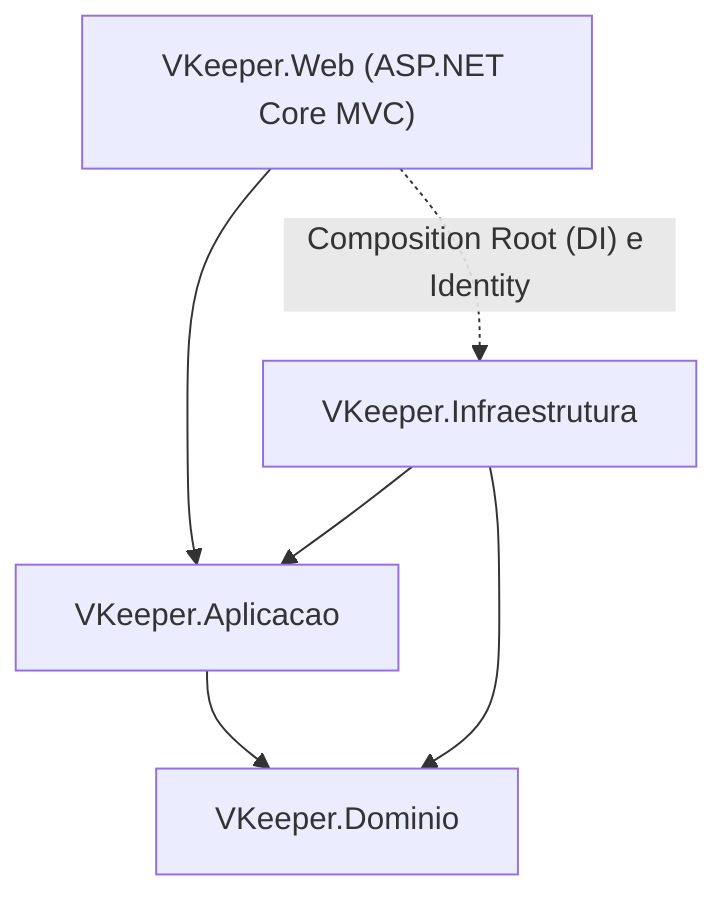

# VKeeper

Aplicação web de gerenciamento de anotações pessoais construída com **C#**, **.NET 10 (LTS)**, **ASP.NET Core MVC**, **Entity Framework Core 10**, **SQL Server**, **Bootstrap 5** e **Clean Architecture**.

Projeto de portfólio profissional com foco em separação de responsabilidades, modelagem de domínio rica, segurança aplicada (OWASP), renderização server-side (padrão PRG — *Post/Redirect/Get*) e testes automatizados unitários e de integração contra SQL Server real.

---

## Funcionalidades do MVP

- **Contas e Autenticação (ASP.NET Core Identity):**
  - Cadastro de conta, login, logout seguro (`POST` anti-CSRF) e alteração de senha com `RefreshSignInAsync`.
  - Isolamento estrito de dados por usuário (`UserId`).
- **Notas (ciclo de vida completo):**
  - CRUD completo com título obrigatório (máx. 150 caracteres), descrição opcional (máx. 5.000 caracteres) e prioridade (`Baixa`, `Média`, `Alta`).
  - Relacionamento **N:N** com categorias pessoais (nenhuma, uma ou várias categorias por nota, com validação de propriedade).
  - **Fixar no topo (Pin)**, **Arquivamento** (visão separada, desfixando automaticamente ao arquivar) e **Lixeira (*soft delete*)** com restauração para notas ativas, exclusão permanente individual e esvaziamento da lixeira.
  - **Busca textual**, **filtros combinados** (categoria + prioridade), **ordenação** (última atualização, criação, prioridade, título) e **paginação** (12 itens por página, com normalização automática de página fora do limite).
- **Categorias:**
  - CRUD completo ordenado alfabeticamente com unicidade normalizada (*case-insensitive* + *trim*) por usuário.
  - Contagem de notas vinculadas ignorando itens na lixeira.
  - Exclusão não destrutiva: remove apenas os vínculos N:N preservando intactas todas as notas.

---

## Arquitetura

O projeto adota **Clean Architecture** organizada em 4 projetos de código e 2 projetos de testes, com a camada `Aplicacao` estruturada por **Feature / Caso de Uso** (`ADR-04`) e convenção de nomenclatura definida na `ADR-16`:



### Estrutura da solução

- `src/VKeeper.Dominio` — Entidades (`Note`, `Category`, `NoteCategory`), enums (`NotePriority`, `NoteSortBy`), exceções de domínio, `BaseEntity` com UUID v7 (`Guid.CreateVersion7()`) e contratos de repositório/UoW. **Zero dependências externas.**
- `src/VKeeper.Aplicacao` — Casos de uso por feature (`Notas/`, `Categorias/`), DTOs, validadores **FluentValidation** e **Result Pattern**. **Zero dependência de EF Core ou ASP.NET Core.**
- `src/VKeeper.Infraestrutura` — `VKeeperDbContext`, `ApplicationUser : IdentityUser<Guid>`, `VKeeperUserClaimsPrincipalFactory`, configurações Fluent API (`ADR-13` sem *Multiple Cascade Paths*), migrations, repositórios isolados por `UserId` e `UnitOfWork`.
- `src/VKeeper.Web` — Controllers MVC (`Home`, `Account`, `Categories`, `Notes`, `Trash`, `Error`), ViewModels, Razor Views em Bootstrap 5 (`pt-BR`), middleware de headers de segurança e Composition Root (`Program.cs`).
- `tests/VKeeper.TestesUnitarios` — Testes unitários de domínio e aplicação com **xUnit**.
- `tests/VKeeper.TestesIntegracao` — Testes ponta a ponta com `WebApplicationFactory<Program>` contra banco SQL Server isolado (**`VKeeperDb_Test`**).

---

## Segurança aplicada

- **Isolamento de dados (anti-IDOR):** todas as consultas e comandos filtram por `UserId` autenticado e validam propriedade de categorias na associação N:N (`RN03`).
- **Proteção CSRF global:** `AutoValidateAntiforgeryTokenAttribute` em todas as ações mutáveis MVC.
- **Cookies endurecidos:** `HttpOnly`, `SameSite` (`Lax`/`Strict`) e `SecurePolicy = Always` fora de desenvolvimento para Identity, Antiforgery e `TempData`.
- **Anti-enumeração e Lockout:** mensagem genérica em credenciais inválidas e bloqueio temporário por 5 minutos após 5 falhas consecutivas.
- **Anti-Open Redirect e Anti-XSS:** validação rigorosa de `ReturnUrl` com `Url.IsLocalUrl` + `LocalRedirect`, zero `@Html.Raw` e `WebEncoderOptions` configurado para UTF-8 seguro em `pt-BR`.
- **Headers HTTP de segurança:** `X-Content-Type-Options`, `X-Frame-Options`, `Referrer-Policy`, `Permissions-Policy` e `Content-Security-Policy`.
- **Higiene de segredos:** `appsettings.Development.json` ignorado no `.gitignore` (template versionado em `appsettings.Development.Example.json`); segredos de produção injetados exclusivamente via variáveis de ambiente / GitHub Actions Secrets.

---

## Como executar localmente

### Pré-requisitos

- [.NET 10 SDK](https://dotnet.microsoft.com/download) (`10.0.x`)
- Microsoft SQL Server (local ou via Docker na porta `1433`)
- Ferramenta `dotnet-ef` (`dotnet tool install --global dotnet-ef`)

### 1. Configurar a connection string de desenvolvimento

Copie `src/VKeeper.Web/appsettings.Development.Example.json` para `src/VKeeper.Web/appsettings.Development.json` (arquivo já protegido no `.gitignore`) e informe sua senha local do SQL Server:

```json
{
  "ConnectionStrings": {
    "DefaultConnection": "Server=localhost,1433;Database=VKeeperDb;User Id=sa;Password=<SUA_SENHA_SQL_SERVER>;TrustServerCertificate=True;"
  }
}
```

### 2. Aplicar as migrations (cria o banco `VKeeperDb` automaticamente)

```bash
dotnet ef database update --project src/VKeeper.Infraestrutura/VKeeper.Infraestrutura.csproj --startup-project src/VKeeper.Web/VKeeper.Web.csproj
```

### 3. Executar a aplicação

```bash
dotnet run --project src/VKeeper.Web/VKeeper.Web.csproj
```

### 4. Executar os testes automatizados

```bash
# Todos os testes (unitários + integração contra banco isolado VKeeperDb_Test)
dotnet test VKeeper.sln

# Apenas testes unitários (sem banco de dados)
dotnet test tests/VKeeper.TestesUnitarios/VKeeper.TestesUnitarios.csproj
```

> Os testes de integração utilizam exclusivamente o banco isolado **`VKeeperDb_Test`** (resolvido por prioridade: variável de ambiente `ConnectionStrings__TestConnection` -> User Secrets -> derivação automática de `appsettings.Development.json` com guarda explícita impedindo execução contra `VKeeperDb`).

---

## Documentação oficial do projeto

- [Planejamento de Produto](docs/planejamento-de-produto.md)
- [Decisões Técnicas e Arquitetura (ADRs e Roadmap)](docs/decisoes-tecnicas.md)
- [Registro de Progresso](docs/progresso.md)
- [Processo de Trabalho dos Agentes](docs/PROCESS.md)
