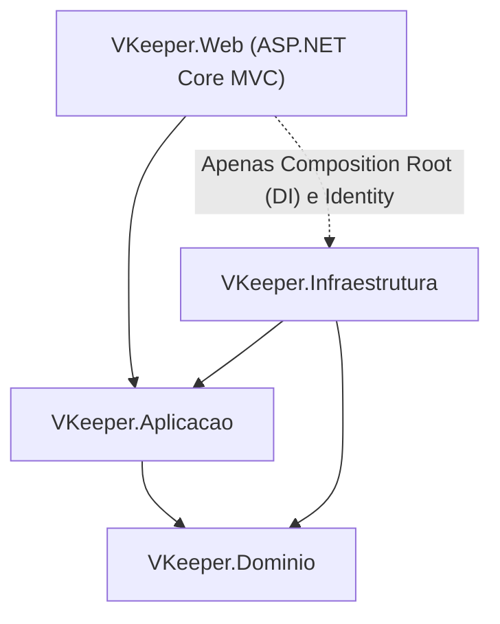
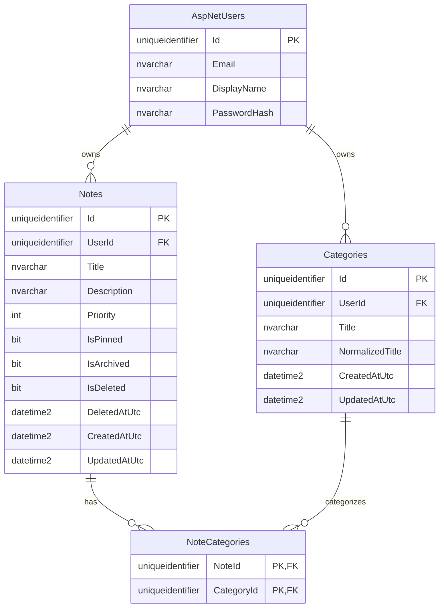

# VKeeper — Decisões Técnicas e Arquitetura

> **Status do documento:** Aprovado (Fase 0 concluída)  
> **Convenção de status das decisões:**  
> - **Aprovada:** decisão fechada durante a entrevista com o solicitante.  
> - **Provisória:** decisão técnica recomendada como ponto de partida, sujeita a ajuste fino antes ou durante a fase correspondente.  
> - **Pendente:** decisão deliberadamente adiada para etapa posterior.

---

## 1. Arquitetura proposta e justificativas

### 1.1. Clean Architecture + ASP.NET Core MVC (SSR)
- **Status:** `Aprovada`
- **Decisão:** adotar **Clean Architecture** organizada em **4 projetos de código** (`Dominio`, `Aplicacao`, `Infraestrutura` e `Web`) com **ASP.NET Core MVC clássico** (renderização no servidor com Razor Views e fluxo **PRG — Post/Redirect/Get**).
- **Justificativa:**
  - Isola regras de negócio puras de detalhes de infraestrutura (EF Core, SQL Server, ASP.NET Core Identity e camada HTTP/MVC).
  - Garante alta testabilidade das camadas internas (`Dominio` e `Aplicacao`) sem dependência de banco ou servidor web.
  - Entrega uma aplicação coesa, segura e idiomática no ecossistema Microsoft, sem a complexidade desnecessária de manter um frontend SPA ou uma API separada.

### 1.2. Endpoints REST complementares
- **Status:** `Aprovada`
- **Decisão:** **não expor endpoints REST/JSON no MVP**; manter 100% ASP.NET Core MVC clássico (PRG).
- **Justificativa:** evita manter duas superfícies de contrato (Views MVC + API JSON) e elimina código JavaScript customizado desnecessário na primeira versão. Caso surja necessidade concreta pós-MVP, a camada `Aplicacao` já estará pronta para ser consumida tanto por controllers MVC quanto por endpoints REST no mesmo projeto `VKeeper.Web`.

### 1.3. Organização interna da camada `Aplicacao`
- **Status:** `Aprovada`
- **Decisão:** organizar `VKeeper.Aplicacao` por **Feature / Caso de Uso** (`Notas/`, `Categorias/` com subpastas por operação como `CriarNota/`, `AtualizarNota/`, `ListarNotas/`, `Lixeira/`, etc.), mantendo **Application Services enxutos** (`NoteService`, `CategoryService`), **Result Pattern** e **FluentValidation** (sem MediatR/CQRS).
- **Justificativa:** une a alta coesão do agrupamento por feature (todos os DTOs/requests/validators de uma operação ficam juntos) com a simplicidade e rastreabilidade direta de serviços de aplicação bem delimitados.

### 1.4. Convenção de idioma em pastas, namespaces e código
- **Status:** `Aprovada` *(alinhada em `AGENTS.md`, seção 2)*
- **Decisão:**
  - **Projetos, pastas e namespaces de código autoral:** em **português** (`VKeeper.Dominio`, `Entidades`, `Excecoes`, `VKeeper.Aplicacao`, `Notas/CriarNota`, `VKeeper.Infraestrutura`, `Persistencia/Configuracoes`, `Repositorios`, `VKeeper.TestesUnitarios`, `VKeeper.TestesIntegracao`).
  - **Pastas e arquivos exigidos ou convencionados pelo framework .NET / ASP.NET Core MVC:** permanecem em **inglês** (`VKeeper.Web`, `Controllers`, `Views`, `Shared`, `ViewModels`, `wwwroot`, `Identity`, `Enums`, `Program.cs`, `appsettings.json`).
  - **Classes, métodos, propriedades, variáveis e comentários técnicos:** em **inglês** (conforme `AGENTS.md`, seção 2).

---

## 2. Stack tecnológica e versões

| Componente | Tecnologia | Versão / Observação | Status |
| --- | --- | --- | --- |
| Plataforma / Runtime | .NET (LTS) | **.NET 10.0** (SDK `10.0.115` presente no ambiente) | `Aprovada` |
| Linguagem | C# | C# 14 (`Nullable` habilitado, `ImplicitUsings` habilitado) | `Aprovada` |
| Framework Web | ASP.NET Core MVC | Renderização server-side com Razor Views (padrão PRG) | `Aprovada` |
| Estilização / UI | Bootstrap | **Bootstrap 5** (+ Bootstrap Icons opcional via arquivos estáticos/libman) | `Aprovada` |
| ORM / Persistência | Entity Framework Core | **EF Core 10** (Code-First, Fluent API, Migrations) | `Aprovada` |
| Banco de Dados | Microsoft SQL Server | **SQL Server Express** em container Docker local (`sqlserver-backend`) em dev; *service container* SQL Server no workflow CI | `Aprovada` |
| Autenticação | ASP.NET Core Identity | `IdentityUser<Guid>` + Cookie Authentication + views MVC próprias | `Aprovada` |
| Validação | FluentValidation + DataAnnotations | FluentValidation na `Aplicacao`; DataAnnotations nos ViewModels (`Web`) | `Aprovada` |
| Logging | `Microsoft.Extensions.Logging` | `ILogger<T>` nativo estruturado | `Aprovada` |
| Testes Automatizados | xUnit | xUnit + `WebApplicationFactory<Program>` + SQL Server de testes | `Aprovada` |
| CI (Integração Contínua) | GitHub Actions | Workflow futuro para build e execução de testes (incluindo SQL Server container) | `Aprovada` |

---

## 3. Estrutura da solução

- **Status:** `Aprovada`

```text
VKeeper/
├── docs/
│   ├── PROCESS.md
│   ├── planejamento-de-produto.md
│   ├── decisoes-tecnicas.md
│   └── progresso.md
├── src/
│   ├── VKeeper.Dominio/
│   │   ├── Comum/                      # BaseEntity e tipos base do domínio
│   │   ├── Entidades/                  # Note.cs, Category.cs, NoteCategory.cs
│   │   ├── Enums/                      # NotePriority.cs (termo técnico padrão .NET)
│   │   ├── Excecoes/                   # DomainException.cs e exceções específicas
│   │   └── Interfaces/                 # INoteRepository.cs, ICategoryRepository.cs, IUnitOfWork.cs
│   ├── VKeeper.Aplicacao/
│   │   ├── Comum/                      # Result.cs, PagedResult.cs, ICurrentUserService.cs, IDateTimeProvider.cs
│   │   ├── Notas/
│   │   │   ├── INoteService.cs
│   │   │   ├── NoteService.cs
│   │   │   ├── CriarNota/              # CreateNoteRequest.cs, CreateNoteValidator.cs
│   │   │   ├── AtualizarNota/          # UpdateNoteRequest.cs, UpdateNoteValidator.cs
│   │   │   ├── ListarNotas/            # ListNotesQuery.cs, NoteListItemDto.cs
│   │   │   ├── ObterNota/              # NoteDetailsDto.cs
│   │   │   └── Lixeira/                # ListTrashQuery.cs, TrashNoteItemDto.cs
│   │   └── Categorias/
│   │       ├── ICategoryService.cs
│   │       ├── CategoryService.cs
│   │       ├── CriarCategoria/         # CreateCategoryRequest.cs, CreateCategoryValidator.cs
│   │       ├── AtualizarCategoria/     # UpdateCategoryRequest.cs, UpdateCategoryValidator.cs
│   │       └── ListarCategorias/       # CategoryListItemDto.cs
│   ├── VKeeper.Infraestrutura/
│   │   ├── Identity/                   # ApplicationUser.cs (: IdentityUser<Guid>), configuração Identity
│   │   ├── Persistencia/
│   │   │   ├── VKeeperDbContext.cs
│   │   │   ├── UnitOfWork.cs
│   │   │   ├── Configuracoes/          # NoteConfiguration.cs, CategoryConfiguration.cs, NoteCategoryConfiguration.cs
│   │   │   └── Migracoes/              # EF Core Migrations
│   │   ├── Repositorios/               # NoteRepository.cs, CategoryRepository.cs
│   │   ├── Servicos/                   # SystemDateTimeProvider.cs
│   │   └── DependencyInjection.cs
│   └── VKeeper.Web/
│       ├── Controllers/                # HomeController, AccountController, NotesController, CategoriesController, TrashController, ErrorController
│       ├── ViewModels/                 # Account/, Notes/, Categories/, Trash/
│       ├── Views/                      # Home/, Account/, Notes/, Categories/, Trash/, Shared/
│       ├── Servicos/                   # CurrentUserService.cs (via IHttpContextAccessor)
│       ├── wwwroot/                    # CSS, JS mínimo do Bootstrap, ícones
│       ├── appsettings.json
│       ├── appsettings.Development.json
│       └── Program.cs                  # Composition Root
├── tests/
│   ├── VKeeper.TestesUnitarios/
│   └── VKeeper.TestesIntegracao/
└── VKeeper.sln
```

### Direção das dependências (regra inviolável)



- `VKeeper.Dominio` **não referencia** nenhum outro projeto nem pacotes externos de infraestrutura (EF Core, Identity, ASP.NET).
- `VKeeper.Aplicacao` referencia **apenas** `VKeeper.Dominio` (e `FluentValidation`). **Não referencia** EF Core nem ASP.NET Core.
- `VKeeper.Infraestrutura` implementa as abstrações de persistência e Identity, referenciando `Aplicacao` e `Dominio`.
- `VKeeper.Web` referencia `Aplicacao` e usa `Infraestrutura` exclusivamente para registro de dependências no `Program.cs` (Composition Root) e integração de Identity em `AccountController` (`NotesController`, `CategoriesController` e `TrashController` conversam exclusivamente com `Aplicacao`).

---

## 4. Responsabilidades das camadas

| Camada | Deve conter | NÃO deve conter |
| --- | --- | --- |
| **Dominio** | Entidades com estado consistente e métodos de comportamento (incluindo máquina de estados Ativa/Arquivada/Lixeira), invariantes de negócio, exceções de domínio, enums (`NotePriority`), interfaces de repositório/UoW. | Anotações de EF Core (`[Table]`, `[Column]`), `DbContext`, `IdentityUser`, lógica HTTP ou ViewModels. |
| **Aplicacao** | Casos de uso agrupados por feature (`NoteService`, `CategoryService`, requests, DTOs, queries, validators `FluentValidation`), `Result`/`PagedResult`, abstrações como `ICurrentUserService`. | Dependência de `Microsoft.EntityFrameworkCore`, `HttpContext`, `IActionResult`, SQL direto ou `TempData`. |
| **Infraestrutura** | `VKeeperDbContext`, `ApplicationUser : IdentityUser<Guid>`, configurações Fluent API, migrations, implementação de repositórios e `UnitOfWork`, registro de DI. | Regras de negócio duplicadas, lógica de apresentação ou dependência de `VKeeper.Web`. |
| **Web** | Controllers MVC (`NotesController`, `CategoriesController`, `TrashController`, `AccountController`), ViewModels, DataAnnotations de UI, Razor Views, filtros anti-CSRF, tratamento global de erro HTTP, `TempData` (PRG), composição de DI. | Consultas diretas ao `VKeeperDbContext`, regras de negócio críticas (unicidade, ownership, transições de estado), strings de conexão em código. |

---

## 5. Modelagem inicial do domínio

- **Status:** `Aprovada`

### 5.1. Estratégia de chaves e isolamento do Identity
- Todas as entidades utilizam `Guid` gerado por `Guid.CreateVersion7()` (nativo no .NET 10), combinando imprevisibilidade nas URLs com ordenação temporal eficiente para índices clusterizados no SQL Server.
- `ApplicationUser : IdentityUser<Guid>` reside exclusivamente em `VKeeper.Infraestrutura.Identity`.
- No `Dominio`, `Note` e `Category` armazenam apenas `Guid UserId`, preservando o núcleo livre de acoplamento ao ASP.NET Core Identity.

### 5.2. Entidades, Enums e Máquina de Estados

- **`NotePriority` (Enum):**
  - `Low = 1` (*Baixa*)
  - `Medium = 2` (*Média — padrão*)
  - `High = 3` (*Alta*)

- **`Note` (Entidade):**
  - `Guid Id`
  - `Guid UserId`
  - `string Title` *(obrigatório, máx. 150)*
  - `string? Description` *(opcional, máx. 5.000)*
  - `NotePriority Priority`
  - `bool IsPinned`
  - `bool IsArchived`
  - `bool IsDeleted` *(exclusão lógica — Lixeira)*
  - `DateTime? DeletedAtUtc` *(preenchido quando `IsDeleted == true`)*
  - `DateTime CreatedAtUtc`
  - `DateTime UpdatedAtUtc`
  - Coleção de associações com categorias (`NoteCategories` — encapsulada como somente leitura) com métodos explícitos de domínio:
    - `UpdateDetails(title, description, priority, utcNow)` *(rejeita se `IsDeleted`)*
    - `UpdateCategories(categoryIds, utcNow)` *(rejeita se `IsDeleted`; impede duplicatas)*
    - `Pin(utcNow)` *(rejeita se `IsArchived` ou `IsDeleted`)*
    - `Unpin(utcNow)` *(rejeita se `IsDeleted`)*
    - `Archive(utcNow)` *(define `IsArchived = true` e `IsPinned = false`; rejeita se `IsDeleted`)*
    - `Unarchive(utcNow)` *(define `IsArchived = false`; rejeita se `IsDeleted`)*
    - `MoveToTrash(utcNow)` *(define `IsDeleted = true`, `DeletedAtUtc = utcNow`, `IsPinned = false`, `IsArchived = false`)*
    - `Restore(utcNow)` *(define `IsDeleted = false`, `DeletedAtUtc = null`, `IsArchived = false`, `IsPinned = false`)*

- **`Category` (Entidade):**
  - `Guid Id`
  - `Guid UserId`
  - `string Title` *(obrigatório, máx. 50)*
  - `string NormalizedTitle` *(armazenado em maiúsculas/trimmed para unicidade confiável por usuário, máx. 50)*
  - `DateTime CreatedAtUtc`
  - `DateTime UpdatedAtUtc`
  - Coleção de vínculos (`NoteCategories`).

- **`NoteCategory` (Entidade de junção explícita N:N):**
  - `Guid NoteId`
  - `Guid CategoryId`
  - Chave primária composta `(NoteId, CategoryId)`.

### 5.3. Diagrama relacional



> **Mitigação de Multiple Cascade Paths no SQL Server (`ADR-13` — `Aprovada`):** configurar `OnDelete(DeleteBehavior.Cascade)` em `Note -> NoteCategories` e `Category -> NoteCategories` (garantindo que a exclusão permanente de uma nota ou a exclusão de uma categoria limpe automaticamente os vínculos na tabela `NoteCategories`, preservando notas ao excluir categoria) e `OnDelete(DeleteBehavior.Restrict)` em `AspNetUsers -> Notes` e `AspNetUsers -> Categories`.

---

## 6. Estratégia de persistência

- **Status:** `Aprovada`
- **Abordagem:** Entity Framework Core 10 Code-First com migrations versionadas em `VKeeper.Infraestrutura/Persistencia/Migracoes/` e mapeamento exclusivamente via **Fluent API** (`IEntityTypeConfiguration<T>`).
- **Acesso a dados:** repositórios específicos por agregado (`INoteRepository`, `ICategoryRepository`) + `IUnitOfWork` (`SaveChangesAsync`), sem repositório genérico expondo `IQueryable`.
- **Otimização de consultas:**
  - `AsNoTracking()` em todas as consultas de listagem e visualização.
  - Paginação (12 itens por página), filtragem e ordenação executadas integralmente no SQL Server (nunca em memória).
  - Contagem de notas por categoria filtrando explicitamente `!Note.IsDeleted`.
  - Filtros de `IsDeleted` aplicados de forma explícita nos métodos de repositório (evitando efeitos colaterais silenciosos de Global Query Filters ao consultar a Lixeira ou restaurar/excluir permanentemente).
- **Índices e restrições no SQL Server:**
  - `Categories`: índice único composto `(UserId, NormalizedTitle)` garantindo RN05 no nível do banco de dados.
  - `Notes`: índice composto `(UserId, IsDeleted, IsArchived, IsPinned, UpdatedAtUtc)` para acelerar listagem ativa, arquivada e lixeira.
  - `NoteCategories`: PK composta `(NoteId, CategoryId)` + índice secundário `(CategoryId, NoteId)` para acelerar filtro por categoria e contagem de notas por categoria.
- **Isolamento de dados:** todos os métodos dos repositórios recebem explicitamente `Guid userId` e aplicam `Where(x => x.UserId == userId)`.

---

## 7. Segurança e autenticação

- **Status:** `Aprovada`
- **Autenticação:** ASP.NET Core Identity (`IdentityDbContext<ApplicationUser, IdentityRole<Guid>, Guid>`) com Cookie Authentication e controllers/views MVC próprias (`AccountController`), sem Razor Pages Default UI.
- **Política de senhas e Lockout:**
  - Comprimento mínimo de 8 caracteres, exigindo letra maiúscula, minúscula e dígito.
  - Lockout habilitado: bloqueio por 5 minutos após 5 tentativas inválidas consecutivas.
  - E-mail único obrigatório (`RequireUniqueEmail = true`).
- **Cookies e transporte:**
  - `HttpOnly = true`, `SecurePolicy = CookieSecurePolicy.Always` (ou `SameAsRequest` apenas em desenvolvimento se necessário), `SameSite = SameSiteMode.Lax`, `SlidingExpiration = true`.
  - Redirecionamento HTTPS (`UseHttpsRedirection`) e `UseHsts` fora de desenvolvimento.
- **Proteção contra vulnerabilidades comuns (OWASP):**
  - **IDOR / Broken Access Control:** toda operação de leitura, edição, pin, arquivamento, envio para lixeira, restauração, exclusão permanente, esvaziamento de lixeira e associação de categoria valida pertencimento ao `UserId` autenticado (`ICurrentUserService`).
  - **CSRF:** `AutoValidateAntiforgeryTokenAttribute` aplicado globalmente para métodos mutáveis (`POST`, `PUT`, `DELETE`) em controllers MVC.
  - **Open Redirect:** `ReturnUrl` validado obrigatoriamente com `Url.IsLocalUrl(returnUrl)` antes de redirecionar após login.
  - **XSS:** renderização via Razor com HTML encoding automático; proibido usar `@Html.Raw` com conteúdo fornecido pelo usuário.
  - **Segredos:** proibido armazenar senhas, connection strings ou chaves no código-fonte ou `appsettings.json` versionado.

---

## 8. Validações e tratamento de erros

- **Status:** `Aprovada`
- **Validação em camadas:**
  1. **Web (ViewModels):** DataAnnotations para validação de formulário, labels em PT-BR e mensagens amigáveis na interface Bootstrap.
  2. **Aplicacao:** `FluentValidation` validando contratos de entrada (`CreateNoteValidator`, `UpdateNoteValidator`, `CreateCategoryValidator`, `UpdateCategoryValidator`, etc.) antes da persistência.
  3. **Dominio:** invariantes obrigatórias e transições de estado protegidas nos construtores e métodos das entidades.
- **Fluxo de falhas de negócio:**
  - Casos de uso retornam `Result` / `Result<T>` com tipo de erro (`Validation`, `NotFound`, `Conflict`, `Forbidden`), evitando exceções para controle de fluxo esperado.
- **Tratamento de exceções não previstas:**
  - Em ambiente não-desenvolvimento, `UseExceptionHandler("/Error")` + `UseStatusCodePagesWithReExecute("/Error/{0}")` renderizando páginas amigáveis (`404`, `403`, `500`) sem vazar stack traces.
  - Em desenvolvimento, página detalhada de exceção para diagnóstico.
- **Feedback na UI (PRG):** mensagens de sucesso e alerta transportadas via `TempData` e exibidas em partial compartilhada de alertas Bootstrap.

---

## 9. Logging

- **Status:** `Aprovada`
- **Implementação:** logging estruturado nativo do ASP.NET Core (`ILogger<T>`), configurado por nível de severidade em `appsettings.json` e `appsettings.Development.json`.
- **Diretrizes:**
  - Registrar eventos relevantes (login falho/lockout, erros de persistência, exceções não tratadas com `TraceIdentifier`).
  - Utilizar templates estruturados sem interpolação de string no log.
  - Nunca registrar senhas, cookies, connection strings ou conteúdo integral sensível das notas em logs de produção.
  - Evolução futura para Serilog ou OpenTelemetry poderá ser feita apenas no Composition Root (`VKeeper.Web`) sem impactar `Dominio` ou `Aplicacao`.

---

## 10. Estratégia de testes

- **Status:** `Aprovada`
- **Framework:** **xUnit**.
- **Projetos de teste:**
  1. **`tests/VKeeper.TestesUnitarios`** (execução rápida, sem I/O):
     - Testes das entidades e invariantes de `Dominio` (`Note`, `Category`, transições Ativa/Arquivada/Lixeira, bloqueio de edição/pin na lixeira, normalização de título, associação N:N sem duplicatas).
     - Testes dos serviços de `Aplicacao` e validators (`FluentValidation`), validando regras de negócio (unicidade por usuário, rejeição de categoria de outro usuário, retorno `NotFound` em acesso indevido).
  2. **`tests/VKeeper.TestesIntegracao`** (`WebApplicationFactory<Program>` + **SQL Server real**):
     - Leitura da connection string de teste por prioridade: **Variável de Ambiente (`ConnectionStrings__TestConnection`) -> User Secrets** — garantindo execução idêntica contra o banco `VKeeperDb_Test` no container local `sqlserver-backend` em desenvolvimento **e** contra o *service container* SQL Server no workflow futuro do GitHub Actions, sem alterar código de teste.
     - Testes de persistência: migrations reais, constraint única `(UserId, NormalizedTitle)`, relacionamento N:N, exclusão de categoria preservando notas, contagem de notas ignorando lixeira e exclusão permanente.
     - Testes ponta a ponta HTTP/MVC: registro, login, redirecionamento anônimo, fluxo CRUD + Pin + Arquivar + Lixeira (mover, restaurar, excluir permanentemente, esvaziar) e **testes explícitos anti-IDOR** entre Usuário A e Usuário B.

---

## 11. Configurações por ambiente

- **Status:** `Aprovada`
- **Arquivos e provedores de configuração:**
  - `appsettings.json`: defaults seguros, níveis de log e estrutura sem segredos (connection string vazia).
  - `appsettings.Development.Example.json`: template versionado no Git documentando a estrutura esperada de `ConnectionStrings:DefaultConnection` (sem senhas reais).
  - `appsettings.Development.json` (**ignorado no `.gitignore`**): armazena a `ConnectionStrings:DefaultConnection` local de desenvolvimento apontando para o SQL Server em Docker (`Server=localhost,1433;Database=VKeeperDb;...`), sem jamais ser versionado no GitHub.
  - **.NET User Secrets** (opcional em desenvolvimento e suportado em `VKeeper.TestesIntegracao` para `ConnectionStrings:TestConnection`).
  - **Variáveis de ambiente / GitHub Actions Secrets** (`ConnectionStrings__DefaultConnection` e `ConnectionStrings__TestConnection`): padrão oficial para CI e deploy automático em produção.
- **Migrations:** aplicadas explicitamente via `dotnet ef database update` durante o desenvolvimento (e automaticamente apenas no bootstrap do banco descartável de `VKeeper.TestesIntegracao`). Não executar `Database.Migrate()` automaticamente em produção sem estratégia controlada.

---

## 12. Infraestrutura, CI e publicação

- **Banco de dados em desenvolvimento (`Aprovada`):**
  - Instância **SQL Server Express em container Docker** já existente no ambiente local (`sqlserver-backend`, porta `1433`), criando bancos dedicados **`VKeeperDb`** (desenvolvimento) e **`VKeeperDb_Test`** (testes de integração locais), configurados em `appsettings.Development.json` (gitignored) e/ou User Secrets.
- **Controle de versão e Workflow de CI/CD (`Aprovada`):**
  - Repositório **Git** com `.gitignore` padrão `.NET` + exclusão de `appsettings.Development.json`.
  - Configuração posterior (Fase 6) de workflow no **GitHub Actions** com *service container* SQL Server (`mcr.microsoft.com/mssql/server`), executando `dotnet restore`, `dotnet build --no-restore` e `dotnet test` (unitários e integração com `ConnectionStrings__TestConnection` injetada pelo workflow), e deploy automático de produção recebendo segredos e senhas exclusivamente via **GitHub Actions Secrets**.
- **Publicação em nuvem (`Pendente`):**
  - Definição do provedor de hospedagem (ex.: Azure App Service + Azure SQL, container Docker em VPS/Render/Fly.io) postergada para após a conclusão e validação do MVP.

---

## 13. Quadro resumo das decisões arquiteturais

| ID | Decisão | Status |
| --- | --- | --- |
| **ADR-01** | Clean Architecture em 4 projetos (`Dominio`, `Aplicacao`, `Infraestrutura`, `Web`) | `Aprovada` |
| **ADR-02** | .NET 10 (LTS) como versão alvo oficial | `Aprovada` |
| **ADR-03** | 100% ASP.NET Core MVC clássico (PRG) no MVP, sem endpoints REST/JSON | `Aprovada` |
| **ADR-04** | `Aplicacao` organizada por Feature/Caso de Uso com Application Services enxutos + Result Pattern (sem MediatR/CQRS) | `Aprovada` |
| **ADR-05** | ASP.NET Core Identity com `IdentityUser<Guid>`, Cookie Auth e telas MVC próprias | `Aprovada` |
| **ADR-06** | Chaves primárias `Guid` (UUID v7 via `Guid.CreateVersion7()`) | `Aprovada` |
| **ADR-07** | Repositórios específicos (`INoteRepository`, `ICategoryRepository`) + `IUnitOfWork` | `Aprovada` |
| **ADR-08** | Validação em 3 níveis (Dominio + FluentValidation + DataAnnotations) | `Aprovada` |
| **ADR-09** | Logging estruturado nativo com `ILogger<T>` | `Aprovada` |
| **ADR-10** | Testes com xUnit (`TestesUnitarios` + `TestesIntegracao` com `WebApplicationFactory` e SQL Server via Env/User Secrets) | `Aprovada` |
| **ADR-11** | SQL Server Express local via container Docker `sqlserver-backend` (`VKeeperDb` / `VKeeperDb_Test`) + *service container* SQL Server no workflow CI | `Aprovada` |
| **ADR-12** | Padronização dos documentos em português (`planejamento-de-produto.md`, `decisoes-tecnicas.md`, `progresso.md`) | `Aprovada` |
| **ADR-13** | `Cascade` em `Note/Category -> NoteCategories` e `Restrict` em `AspNetUsers -> Notes/Categories` (anti Multiple Cascade Paths) | `Aprovada` |
| **ADR-14** | Inicialização do Git na Fase 1 e workflow CI no GitHub Actions na Fase 6 | `Aprovada` |
| **ADR-15** | Estratégia de hospedagem e deploy em nuvem pós-MVP | `Pendente` |
| **ADR-16** | Projetos, pastas e namespaces de código autoral em português; pastas e arquivos convencionados pelo framework em inglês | `Aprovada` |
| **ADR-17** | Inclusão de Lixeira (*soft delete*, restauração e exclusão permanente) no MVP com máquina de estados explícita (`IsDeleted`, `DeletedAtUtc`) | `Aprovada` |
| **ADR-18** | Rebrand completo da marca e da solução de `VanderKeep` para `VKeeper` (`VKeeper.sln`, projetos/namespaces `VKeeper.*`, `VKeeperDbContext`, banco `VKeeperDb`) | `Aprovada` |
| **ADR-19** | Connection string local de desenvolvimento em `appsettings.Development.json` (ignorado no `.gitignore` com `appsettings.Development.Example.json` versionado) e segredos de produção via GitHub Actions Secrets | `Aprovada` |

---

## 14. Decisões pendentes e alertas de governança

1. **Hospedagem e deploy em nuvem (ADR-15):** definir após a conclusão do MVP.

---

## 15. Roadmap de implementação

Cada fase deve seguir integralmente o fluxo definido em `docs/PROCESS.md` (Preparação -> Implementação pelo Developer -> Revisão independente pelo Reviewer -> Correções -> Atualização de `docs/progresso.md`).

### Fase 0 — Descoberta, Planejamento e Arquitetura *(Concluída)*
- **Objetivo:** consolidar requisitos, regras de negócio, decisões técnicas e roadmap.
- **Entregáveis:** `docs/planejamento-de-produto.md`, `docs/decisoes-tecnicas.md`, `docs/progresso.md` e alinhamento de referências em `docs/PROCESS.md` e `.agents/agents/architect/agent.md`.
- **Status:** Concluída e aprovada.

### Fase 1 — Fundação da Solução e Infraestrutura Base *(Concluída)*
- **Objetivo:** estruturar a solução Clean Architecture em `.NET 10` seguindo a convenção de pastas/namespaces aprovada, configurar projetos, dependências, DI base, logging, Git, User Secrets e ambiente de testes.
- **Entregáveis:**
  - `VKeeper.sln` e projetos `VKeeper.Dominio`, `VKeeper.Aplicacao`, `VKeeper.Infraestrutura`, `VKeeper.Web`, `VKeeper.TestesUnitarios` e `VKeeper.TestesIntegracao`.
  - Referências entre projetos respeitando rigorosamente a direção da Clean Architecture.
  - Inicialização do Git + `.gitignore`, layout base Bootstrap 5 e páginas globais de erro (`404`, `403`, `500`).
  - Configuração base de `VKeeperDbContext`, inicialização de User Secrets em `VKeeper.Web` e `VKeeper.TestesIntegracao` e verificação de build + execução dos projetos de teste.
- **Status:** Concluída e aprovada em revisão técnica independente (2026-11-26).

### Fase 2 — Domínio e Persistência Core (Notas, Categorias N:N e Soft Delete) *(Concluída)*
- **Objetivo:** implementar o modelo de domínio completo (incluindo máquina de estados Ativa/Arquivada/Lixeira), mapeamentos Fluent API, repositórios, `UnitOfWork` e migrations iniciais.
- **Entregáveis:**
  - Entidades `Note`, `Category`, `NoteCategory`, enums `NotePriority` e `NoteSortBy`, exceções de domínio e interfaces `INoteRepository`, `ICategoryRepository`, `IUnitOfWork`.
  - `ApplicationUser : IdentityUser<Guid>`, `VKeeperDbContext`, configurações Fluent API (`Configuracoes/`), índice único `(UserId, NormalizedTitle)`, índice composto de `Notes` com `IsDeleted` e estratégia anti-cascade-paths (`ADR-13`).
  - Migration inicial (`20261127001307_InitialCreate`) aplicada com sucesso no banco `VKeeperDb` (container `sqlserver-backend`).
  - Testes unitários de domínio (`VKeeper.TestesUnitarios`) cobrindo todas as invariantes, fronteiras e transições de estado.
- **Status:** Concluída, auditada e validada com aplicação real da migration no SQL Server (2026-11-27).

### Fase 3 — Autenticação, Contas e Segurança (ASP.NET Core Identity) *(Concluída)*
- **Objetivo:** implementar cadastro, login, logout, alteração de senha e infraestrutura de usuário autenticado (`ICurrentUserService`).
- **Entregáveis:**
  - Configuração completa do ASP.NET Core Identity (`ApplicationUser` inicializando `Id = Guid.CreateVersion7()` no construtor, `VKeeperUserClaimsPrincipalFactory` com `CustomClaimTypes.DisplayName`, política de senha, lockout, cookies endurecidos em Identity/Antiforgery/TempData e CSRF global).
  - `AccountController`, `IdentityErrorTranslator`, ViewModels e views MVC próprias em Bootstrap (`Register`, `Login`, `ChangePassword`, `AccessDenied` -> `403`, navbar autenticada em `_Layout.cshtml`).
  - `CurrentUserService` integrado ao `HttpContext` e coberto por testes dedicados.
  - Testes de integração contra o banco SQL Server isolado `VKeeperDb_Test` cobrindo cadastro, login, logout, alteração de senha, senha fraca, lockout efetivo, redirecionamento anônimo, validação de `ReturnUrl` local e proteção contra Open Redirect (`https://` e `//`), CSRF e atributos `Set-Cookie`.
- **Status:** Concluída, validada contra `VKeeperDb_Test` e aprovada em revisão de segurança independente (2026-11-27).

### Fase 4 — Casos de Uso e MVC de Categorias
- **Objetivo:** entregar o fluxo completo de gerenciamento de categorias pessoais.
- **Entregáveis:**
  - `CategoryService`, requests/DTOs e validadores FluentValidation sob `VKeeper.Aplicacao/Categorias/`.
  - `CategoriesController`, ViewModels e Razor Views em Bootstrap (Index com contagem de notas não excluídas, Create, Edit, confirmação de Delete com aviso de preservação das notas).
  - Testes unitários de `CategoryService` e testes de integração (unicidade por usuário, contagem ignorando lixeira e anti-IDOR).
- **Critério de conclusão:** critérios de aceite de US11 e US12 validados por testes automatizados e revisados.

### Fase 5 — Casos de Uso e MVC de Notas e Lixeira (CRUD, N:N, Pin, Arquivar, Lixeira, Busca e Filtros)
- **Objetivo:** entregar o núcleo funcional completo do VKeeper.
- **Entregáveis:**
  - `NoteService`, queries, requests/DTOs e validadores FluentValidation sob `VKeeper.Aplicacao/Notas/`.
  - `NotesController` e `TrashController`, ViewModels e Razor Views em Bootstrap (Notas Ativas, Arquivadas, Lixeira, Detalhes, Criar, Editar, confirmações de exclusão permanente e esvaziar lixeira).
  - Testes unitários de `NoteService` e testes de integração cobrindo N:N, exclusão de categoria preservando notas, filtros combinados, paginação (12 itens), Pin/Archive, Lixeira (mover, restaurar, excluir permanentemente, esvaziar) e testes anti-IDOR completos.
- **Critério de conclusão:** critérios de aceite de US04 a US10 e US13 validados com testes unitários e de integração verdes.

### Fase 6 — Polimento de UX, Hardening, Workflow CI e Fechamento do MVP
- **Objetivo:** finalizar acabamentos de interface, revisar segurança/desempenho, configurar o workflow no GitHub Actions e consolidar documentação final.
- **Entregáveis:**
  - Revisão visual e responsiva (estados vazios, alertas `TempData`, acessibilidade básica, badges de prioridade/categorias e navegação Ativas/Arquivadas/Lixeira).
  - Revisão final de consultas SQL/índices, headers de segurança e logging.
  - Workflow CI em `.github/workflows/` com *service container* SQL Server executando build e testes unitários + integração automaticamente, além de `README.md` com guia de setup local.
  - Auditoria técnica final do Reviewer e atualização completa de `docs/progresso.md`.
- **Critério de conclusão:** MVP completo, auditado, com CI verde e pronto para demonstração em portfólio (e eventual fase futura de publicação em nuvem).
